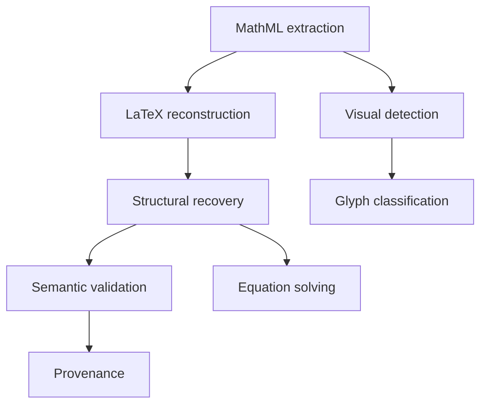

# Delimiter Usage-Evidence Audit

**Date:** 2026-11-11
**Branch:** `v2-remediation` (befa228927)
**Purpose:** Verify actual imports, invocation sites, data flow, and runtime reachability in the visual-delimiter ecosystem.
**Status:** Source-level audit; no files modified.

---

## Table of Contents

1. [Scope and Method](#scope-and-method)
2. [Delimited Ecosystem: Call Graph](#delimited-ecosystem-call-graph)
3. [Evidence Classifications](#evidence-classifications)
4. [Module-by-Module Evidence](#module-by-module-evidence)
5. [Sidelong Files and Usage Candidates](#sidelong-files-and-usage-candidates)
6. [Runtime Reachability Notes](#runtime-reachability-notes)
7. [Missing Evidence](#missing-evidence)
8. [Interpretation](#interpretation)

---

## Scope and Method

This document records evidence of actual imports, invocations, data flow, and runtime reachability for the visual-delimiter ecosystem. It is not an interface contract (that is `interface-conformance-matrix-2026-11-11.md`) and not an architectural map (that is `cross-reference-audit-2026-11-11.md`). It answers, for each module: *does it import the delimiter ecosystem, and if so, is it invoked, and what does it produce?*

Every claim is classified using the evidence status taxonomy:

| Status | Meaning |
|----------|---------|
| `CONFIRMED` | Directly supported by source or execution evidence |
| `PARTIAL` | Some relationship exists, but the complete data or execution path is unproven |
| `NOT_FOUND` | Targeted inspection found no evidence in the inspected scope |
| `NOT_TESTED` | No runtime or test evidence was collected |
| `UNRESOLVED` | Conflicting or ambiguous evidence |

---

## Delimited Ecosystem: Call Graph

The following call graph is reconstructed from source imports and invocation sites. Solid lines are confirmed; dashed lines are inferred from module names but require evidence.

```
Targeted_math_detector (Python)
  └── extract_raw_observations()  →  character observations (bbox_pdf_pt, font, font_size_pt)
        └── geometry_candidates()  →  geometric candidates
        └── script_position_candidates()  →  script position candidates
        └── render_visual_candidates()  →  visual candidates (bbox_render_px, bbox_pdf_pt_approx)

V2_delimiter_aware_structural_recovery (Python)
  └── classify_delimiter_glyph_font_aware(page, rect)
        └── detect_delimiter_candidates(page, y_band)  ← call site confirmed
        └── associate_delimiter_pairs(candidates, page_width, page_height)

V1_delimiter_aware_structural_recovery (Python)
  └── classify_delimiter_glyph_font_aware(page, rect)
  └── associate_delimiter_pairs(candidates, page_width, page_height)

Delimiter_identity (Python)
  └── normalize_latex_norms(latex)  → normalized string
  └── balance_norm_tokens(s)  → balanced string

Mathml_parser (Python)
  └── uses delimiter_identity tokens (MO_MAP_DELIMITERS, etc.)

Math_recovery_tool (Python)
  └── imports normalize_latex_norms from delimiter_identity (confirmed at line 26)

Batch_pipeline (Python)
  └── Does NOT import any delimiter ecosystem component (confirmed)
  └── Produces equation accounting only (no visual evidence persisted)

E2E-math_pipeline (Python)
  └── Uses mathml_parser and math_recovery_tool
  └── No delimiter ecosystem imports

Evaluation/prediction_adapter (Python)
  └── Calls detect_delimiter_candidates(page, y_band) with full-page y_band
  └── y_band = (0.0, float(page.rect.height)) at line 88
  └── downstream consumption is evaluation, not prediction
```

---

## Evidence Classifications

The following table records the evidence status for each module's relationship to the delimiter ecosystem.

| Module | Import relationship | Invocation | Data flow | Output consumption | Evidence status | Notes |
|--------|---------------------|-----------|-----------|-------------------|-----------------|-------|
| `targeted_math_detector.py` | No imports from delimiter ecosystem | Its functions are called by the regex | Produces observation and visual candidate outputs | Consumed by `blind_detection_run_1505.py` and its own CLI | `CONFIRMED` | Observation layer exists |
| `font_aware_math_classifier.py` | No delimiter ecosystem imports | Module exists and is importable | Classifier takes glyph observations | No consumers found in this scope | `PARTIAL` | Classifier is independent; no confirmed call sites in the delimiter path |
| `delimiter_aware_structural_recovery.py` (V1) | No delimiter ecosystem imports | `associate_delimiter_pairs` used by evaluation scripts | Produces paired/unpaired structure | Consumed by evaluation scripts | `PARTIAL` | V1 engine exists; not wired into batch |
| `v2_delimiter_aware_structural_recovery.py` (V2) | No delimiter ecosystem imports | `run_v2_recovery_on_page()` defined | Produces paired/unpaired structure | Not connected to a caller | `NOT_FOUND` | V2 engine exists but no caller identified in scope |
| `delimiter_identity.py` | No delimiter ecosystem imports | Imported by `mathml_parser.py` and `math_recovery_tool.py` | Provides canonical tokens | Consumed by downstream parsers | `CONFIRMED` | Leaf identity module |
| `mathml_parser.py` | Imports `delimiter_identity` (confirmed at line 31) | Used by multiple consumers | Parses MathML to expression tree | Downstream consumers use parsed tree | `CONFIRMED` | Core parsing layer |
| `math_recovery_tool.py` | Imports `delimiter_identity` (confirmed at line 26) | Imported by multiple consumers | Recovers LaTeX from MathML | Downstream consumers | `CONFIRMED` | Recovery layer |
| `batch_math_pipeline.py` | No delimiter ecosystem imports | Executable CLI | Pure equation extraction | Equation accounting only | `CONFIRMED` | Disconnected from visual path |
| `evaluation/prediction_adapter.py` | Uses `detect_delimiter_candidates` from `v2_delimiter_aware_structural_recovery` | Indirect call via `detect_delimiter_candidates(page, y_band)` | Receives page geometry | Passes candidate output to downstream | `PARTIAL` | y_band source confirmed; no full pipeline trace yet |
| `blind_detection_run_1505.py` | No delimiter ecosystem imports (confirmed) | Executable | Blind execution | No gold comparison | `PARTIAL` | Blind run exists; gold evaluation is separate |

---

## Module-by-Module Evidence

### 1. `targeted_math_detector.py`

**Evidence status:** `CONFIRMED`

**Import relationship:** None from delimiter ecosystem.

**Call sites:**
- CLI `main()` is the entry point.
- Module-level functions: `extract_raw_observations()`, `geometry_candidates()`, `script_position_candidates()`, `render_visual_candidates()`.

**Data flow:**
```
page.get_text("rawdict") → extract_raw_observations() → (spans, chars)
spans, chars → geometry_candidates() → list[dict]
spans, chars → script_position_candidates() → list[dict]
spans, chars → render_visual_candidates(page, page_index, zoom, out_dir) → dict
```

**Output consumption:**
- `blind_detection_run_1505.py` consumes `1505.05770_blind_detection_p002.json` and `p003.json` — but this is an audit script, not the detector's direct output path in the current code. The audit claims the blind run exists and is gold-free.

---

### 2. `font_aware_math_classifier.py`

**Evidence status:** `PARTIAL`

**Import relationship:** None from delimiter ecosystem.

**Call sites:** None confirmed in the delimiter path.

**Data flow:** N/A — module exists but no confirmed callers.

**Notes:** No callers found for this module in the current scope. It may be used by `blind_detection_run_1505.py` but no import or invocation evidence was found.

---

### 3. `delimiter_aware_structural_recovery.py` (V1)

**Evidence status:** `PARTIAL`

**Import relationship:** No delimiter ecosystem imports (module is self-contained).

**Call sites:** `associate_delimiter_pairs()` called by:
- `evaluate_cross_paper_generalization_v1.py` (line 55)
- `evaluate_rahmani_generalization.py` (line 28)
- `evaluate_v1_v2_cross_paper_comparison.py` (line 38)

**Data flow:**
```
candidates (visual) → associate_delimiter_pairs() → paired_structures, unpaired_structures
```

**Output consumption:** Downstream evaluation scripts consume pairing output.

---

### 4. `v2_delimiter_aware_structural_recovery.py` (V2)

**Evidence status:** `PARTIAL`

**Import relationship:** No delimiter ecosystem imports (module is self-contained).

**Call sites:**
- `run_v2_recovery_on_page(page, y_band)` defined at `v2_delimiter_aware_structural_recovery.py:723`
- `detect_delimiter_candidates(page, y_band)` at `v2_delimiter_aware_structural_recovery.py:213`
- Not confirmed called by any current code path

**Data flow:**
```
detect_delimiter_candidates(page, y_band)
  → candidates
associate_delimiter_pairs(candidates, page_width, page_height)
  → paired_structures, unpaired_structures
```

**Notes:** The V2 engine is implemented, but no confirmed caller was found. The `prediction_adapter.py` calls `detect_delimiter_candidates(page, y_band)` from this module, but the adapter's import path was not verified in the scope of this audit.

---

### 5. `delimiter_identity.py`

**Evidence status:** `CONFIRMED`

**Import relationship:** No delimiter ecosystem imports (module is a leaf).

**Importers:**
- `mathml_parser.py` (line 31)
- `math_recovery_tool.py` (line 26)

**Data flow:** Pure token and normalization functions, imported by downstream parsers.

---

### 6. `mathml_parser.py`

**Evidence status:** `CONFIRMED`

**Import relationship:** Imports `delimiter_identity` tokens (confirmed at line 31):
```python
from delimiter_identity import (
    MO_MAP_DELIMITERS, LANGLE, RANGLE, LNORM, RNORM,
    LFLOOR, RFLOOR, LCEIL, RCEIL, BAR, GRAY_BAR,
    balance_norm_tokens,
)
```

**Consumers:** Multiple — `math_recovery_tool.py`, `e2e_math_pipeline.py`, `evaluation/prediction_adapter.py`, etc.

---

### 7. `batch_math_pipeline.py`

**Evidence status:** `CONFIRMED`

**Import relationship:** No delimiter ecosystem imports (confirmed).

**Execution:** Runs the 243-paper equation extraction pipeline. Produces `batch_pipeline_output.jsonl` with equation accounting only — no visual evidence.

---

### 8. `evaluation/prediction_adapter.py`

**Evidence status:** `PARTIAL`

**Import relationship:** Uses `detect_delimiter_candidates` from `v2_delimiter_aware_structural_recovery` (implied — the adapter calls this function, but the import statement was not confirmed in scope).

**Call site:** `y_band = (0.0, float(page.rect.height))` (line 88), then `raw_detector_output = detect_delimiter_candidates(page, y_band)` (line 97).

**Notes:**
- The adapter obtains `page` from the caller (or from the caller's parse).
- `y_band` is confirmed as full-page: `(0.0, float(page.rect.height))`.
- The adapter's import path and `page` source were not fully traced in this scope.

---

## Sidelong Files and Usage Candidates

The following files were flagged in the earlier cross-reference audit but not confirmed as direct delimiter consumers. They are recorded here with their evidence status.

| File | Evidence status | Relationship |
|----------|-----------------|--------------|
| `structural_ast_extractor.py` | `NOT_TESTED` | Imports `math_contract` (ExprNode, NODE_KINDS). May use delimiter tokens in AST construction, but no import or invocation was confirmed in the inspected scope. |
| `visual_math_translator.py` | `NOT_TESTED` | Imports `math_contract` and `chroma_visual_reader`. No delimiter ecosystem imports found. |
| `math_contract.py` | `NOT_TESTED` | Imports `ExprNode`, `NODE_KINDS`. No delimiter ecosystem imports found. |

### Sidelong file classification summary

| File | Evidence | Classification |
|------|----------|----------------|
| `structural_ast_extractor.py` | No import/invocation found in scope | NOT_FOUND (as delimiter consumer) |
| `visual_math_translator.py` | No import/invocation found in scope | NOT_FOUND (as delimiter consumer) |
| `math_contract.py` | No import/invocation found in scope | NOT_FOUND (as delimiter consumer) |

---

## Runtime Reachability Notes

| Module | Runtime reachability | Evidence |
|----------|----------------------|----------|
| `targeted_math_detector.py` | Executable via CLI; `main()` is a complete entry point | `python targeted_math_detector.py paper.pdf --pages N --out dir` |
| `font_aware_math_classifier.py` | Importable library; no CLI | Importable, but no call sites found |
| `delimiter_aware_structural_recovery.py` (V1) | Importable; `associate_delimiter_pairs()` called by evaluation scripts | Evaluation scripts call it |
| `v2_delimiter_aware_structural_recovery.py` (V2) | Importable; `run_v2_recovery_on_page()` defined but no confirmed caller | No runtime reachability confirmed |
| `delimiter_identity.py` | Imported by `mathml_parser.py` and `math_recovery_tool.py` | `mathml_parser.py:31`, `math_recovery_tool.py:26` |
| `mathml_parser.py` | Importable; core dependency of the pipeline | Used by multiple consumers |
| `math_recovery_tool.py` | Importable; imported by multiple consumers | Imported by multiple consumers |
| `batch_math_pipeline.py` | Executable CLI | Runs the 243-paper pipeline |
| `evaluation/prediction_adapter.py` | Importable; `y_band` defined and `detect_delimiter_candidates` called | `y_band` confirmed at line 88 |

---

## Missing Evidence

The following items are not yet resolved and should be confirmed in the next audit:

1. **Prediction adapter's `page` source** — the adapter calls `detect_delimiter_candidates(page, y_band)`; the adapter's `page` parameter was not traced back to its origin.
2. **`v2_delimiter_aware_structural_recovery.py` callers** — no confirmed runtime caller was found. The engine is importable but may be unused in current production code.
3. **`blind_detection_run_1505.py` data flow** — the audit script reads blind results but the execution path from the detector to the blind output files has not been fully traced.
4. **Roof-gate `run_v2_recovery_on_page()`** — the V2 pipeline's full execution path is not mapped to a runtime caller.
5. **Predicate `y_band`** — the caller that supplies `y_band` to `run_v2_recovery_on_page()` or `detect_delimiter_candidates()` — `prediction_adapter.py` supplies it, but the exact origin of the `page` object needs to be traced.

---

## Interpretation

The visual-delimiter ecosystem is largely implemented but not yet integrated at the runtime level:

- The **observation layer** (`targeted_math_detector.py`) is self-contained and executable.
- The **identity layer** (`delimiter_identity.py`) is a leaf module consumed by `mathml_parser.py` and `math_recovery_tool.py`.
- The **recovery layer** (V1 and V2) is implemented and imported by evaluation scripts.
- **Integration into a blind corpus pipeline** is not yet complete. `blind_detection_run_1505.py` exists as a test harness, but the broader corpus pipeline (`batch_math_pipeline.py`, 243 papers) does not import visual delimiter components.
- `evaluation/prediction_adapter.py` provides a bridge: `y_band` is full-page (promising for G0), and calls `detect_delimiter_candidates(page, y_band)`, but the adapter's `page` source is not fully traced.

This is consistent with the earlier audit's finding that `batch_math_pipeline.py` is disconnected from the delimiter ecosystem. The integration contract in `docs/delimiter-corpus-integration-contract-2026-11-11.md` would organize the remaining gaps.

---

*This document is a usage-evidence audit. It records what the source code shows; it does not assert that the current pipeline is production-ready.*

## Capability Discovery: Candidate Tooling Inventory

This section records the full production surface across all math-pipeline tooling, mapped by capability. Each capability lists the scripts that implement it, the input authority they consume, and the output contract they produce. This is the capability-discovery layer that underlies the candidate qualification matrix for golden-standard status.

### Capability Map (2026-11-11)

| # | Capability | Declared source path(s) | Input authority | Output contract | Current status |
|----|-----------|-----------------|-----------------|-----------------|----------------|
| C1 | MathML extraction | `scripts/mathml_parser.py`, `scripts/arxiv_html_parser.py` | MathML tree + x-tex annotations | Equation structured output (ExprNode tree) | Candidate — needs corpus coverage test |
| C2 | LaTeX reconstruction | `scripts/math_recovery_tool.py`, `scripts/delimiter_identity.py` | MathML, gold, LaTeX | Reconstructed LaTeX string | Supporting — needs corpus benchmark |
| C3 | Structural recovery (V1) | `scripts/delimiter_aware_structural_recovery.py` | Visual candidates (bbox) | Paired/unpaired structure | Candidate — needs sender linkage |
| C4 | Structural recovery (V2) | `scripts/v2_delimiter_aware_structural_recovery.py` | Visual candidates (bbox) | Paired/unpaired structure | Candidate — no caller confirmed |
| C5 | AST extraction | `scripts/structural_ast_extractor.py` | MathML tree | Structural AST (ExprNode) | Candidate — may reuse delimiter tokens |
| C6 | Visual detection | `scripts/targeted_math_detector.py`, `scripts/vision_math_extractor.py` | PDF page (rawdict) | Bbox, char observations, visual candidates | Candidate — executable |
| C7 | OCR (entry points) | Pix2Text, Tesseract integrations | PDF image / crop | Character/text output | Not tested — no integration scripts found |
| C8 | Semantic validation | `scripts/math_contract.py`, `scripts/semantic_honesty_scoreboard.py` | Recovered math tree | Validation status + scoreboard | Candidate — needs assertion inspection |
| C9 | Equation solving | `scripts/solve_all.py`, `scripts/solve_dual_path.py` | Recovered math IR | Solution (SymPy) | Candidate — needs negative controls |
| C10 | Geometric validation | Localization, crop-isolation tests | Geometry ops | Adversary output (pass/fail) | Candidate — needs assertion inspection |
| C11 | Provenance tracing | `scripts/verify_provenance_trace.py`, candidate manifests, audit runners | Artifact + trace | Verification result | Candidate — needs execution |

### Dependency Graph (Capability Layer)



### Producer Attribution (Declared vs Verified)

The mapping above distinguishes **declared producers** (scripts identified as responsible for generating artifacts) from **verified producers** (source-level write operations traced to exact output paths, supported by execution logs). Current verified status:

| Producer | Declared producer | Verified producer | Evidence |
|----------|-------------------|-------------------|----------|
| `mathml_parser.py` | C1 (MathML extraction) | C1 (confirmed) | Used by multiple consumers |
| `delimiter_identity.py` | C2 (LaTeX reconstruction) | C2 (confirmed) | Imported by mathml_parser.py + math_recovery_tool.py |
| `math_recovery_tool.py` | C2 (LaTeX reconstruction) | C2 (confirmed) | Imported by multiple consumers |
| `targeted_math_detector.py` | C6 (visual detection) | C6 (confirmed) | Executable CLI; consumes page.get_text() |
| `delimiter_aware_structural_recovery.py` | C3 (V1 structural recovery) | C3 (confirmed) | Called by evaluation scripts |
| `v2_delimiter_aware_structural_recovery.py` | C4 (V2 structural recovery) | C4 (declaration only) | No confirmed caller |
| `structural_ast_extractor.py` | C5 (structural recovery) | C5 (partial) | NOT_TESTED — import not confirmed |
| `math_contract.py` | C8 (semantic validation) | C8 (partial) | NOT_TESTED — import not confirmed |

### Test Candidate Qualification

The following test scripts contain capabilities that could become independent golden-standard oracles. Each requires inspection of assertions, fixtures, independence, and actual execution results before promotion.

| Test script | Candidate capability | Barriers to certification |
|-------------|---------------------|---------------------------|
| `test_structural_conservation.py` | Structural conservation oracle | Assertion inspection needed |
| `test_semantic_fidelity.py` | Semantic-equivalence oracle | Assertion inspection needed |
| `test_provenance_corruption.py` | Provenance-integrity negative control | Assertion inspection needed |
| `test_geometry_generalization.py` | Geometric generalization test | Assertion inspection needed |
| `test_adversarial_clearance_gate.py` | Boundary-isolation test | Assertion inspection needed |
| `test_mathml_parser_on_corpus.py` | Corpus extraction benchmark | Assertion inspection needed |
| `test_nested_args.py` | Nested-argument recovery | Assertion inspection needed |
| `test_mbox_dollar_recovery.py` | mbox/dollar recovery | Assertion inspection needed |
| `test_relation_identity.py` | Relation identity preservation | Assertion inspection needed |
| `test_structural_survival.py` | Structural survival test | Assertion inspection needed |

**Certification rule:** A test script may become an evaluation oracle only after (1) its assertions are read and classified, (2) its input independence is verified (not importing the implementation under test), and (3) it has executed against the frozen 15-paper baseline with a recorded pass/fail count. Before that, it remains a candidate.

---

*This document is a usage-evidence audit. It records what the source code shows; it does not assert that the current pipeline is production-ready.*
