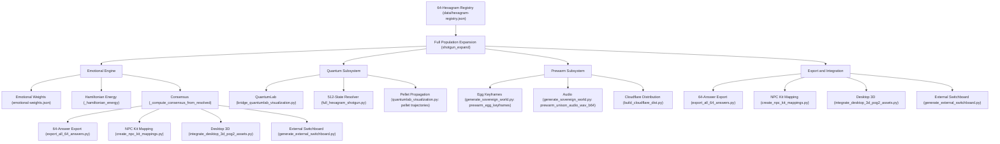

# Diagnose System Models (14) — Research Continuity Record

**Date:** 2026-11-09
**Source:** Recovered conversation history (October 2026 – November 2026)
**Purpose:** Preserve recovered technical details, exact paths/measurements, decisions, corrections, dependencies, and unresolved questions across King Wen research threads.
**Status:** Working record — provisional until independently verified

---

## 1. Executive Summary

The recovered conversation records span a King Wen computational research effort across multiple workstreams:

| Thread | Date | Focus | Status |
|--------|------|-------|--------|
| King Wen training lineage | Oct 4 | Data generation, Megatron integration | Partially verified |
| Visual evaluation & publication evidence | Oct 25 | 21-candidate visual audit, parser metrics | Partially verified |
| Math extraction, reconstruction, preservation | Nov 4–6 | PDF math extraction, delimiter evaluation | Partially verified |
| Mechanical Swan architecture | Nov 7 | Unified King Wen computational system | Architectural documentation |
| Repository divergence & publication classification | Nov 7–9 | Branch comparisons, publication gates | Partially verified |

**Key finding:** The recovered context is sufficient to reconstruct the major research threads, but several claims remain unverified (e.g., complete Megatron training runs, OCR fidelity beyond 20/21 crops, and runtime execution of HEX43-003 specification).

---

## 2. King Wen Training Lineage (October 4)

### 2.1 Component inventory

| Component | Role | Status |
|-----------|------|--------|
| `kingwen_training.py` | Main pooled-weight trainer; generates Megatron-compatible batch data | Documented |
| `build_full_shotgun_jsonl.py` | Builds the expanded training corpus | Documented |
| `regenerate_training_data.py` | Regenerates training data | Documented |
| `recover_training_data.py` | Recovery tooling for generated training data | Documented |
| `build_per_hex_training_data.py` | Produces per-hexagram training partitions | Documented |
| `build_pretrain.py` | Converts resolved collapse-state data into pretraining JSONL | Documented |
| `KingwenDataset` | Integrates King Wen records into Megatron's dataset pipeline | Documented |

### 2.2 Pretraining transformation

**Input:** `collapse_full_128_output.json`
**Output:** `kingwen_pretrain.jsonl`

Per resolved state, the transformation emits:
- Two records per resolved state.
- Identity and phase retained.
- Polarity and injection pools retained.
- Porosity and reason retained.
- Five-axis vectors and yao values retained.
- Source provenance set to `collapse_full_128`.

**Integration:** `KingwenDataset` → `BlendedMegatronDatasetBuilder`

**Important qualification:** Porosity was reported as affecting sample weighting. The available evidence did not establish a dedicated neural-network porosity head.

### 2.3 Per-hexagram partitions

Output paths: `output/per_hex_training/1.jsonl` through `64.jsonl`

Records included: paper, hexagram, vector, and porosity metadata.

**Schema verification (2026-11-10):** Each canonical record carries 2 top-level keys — `text` and `label_payload`. The `label_payload` is a nested dictionary with **43 named keys** (hexagram_id, request_text, phase_bits, phase_temporal, hexagram_symbols, intent, inject_site, yao_vocabulary, line_states, line_balance, sample_paths, expanded_vector, resolved_vector, quantum_avatar_state, pre_slider, post_slider, projections, schauberger_metrics, schauberger_parsing, ternary_slots, skill_cards, tool_native_map, avalokiteshvara_arm, jkd_pedagogy_anchor, quantum_superposition, hermes_layer, schauberger_parsing, projections, coder_specialty, rs3_actionable, nominal_state, voice_pool_size, and 21 more). Schema is uniform across all 1,536 records — every record has the same 43 nested keys.

**Uniform 64-identity expansion (user-confirmed):** Hexagram IDs 1–64 participate equally within a shared structural schema. Queries against individual IDs preserve the same output structure; only identity-specific metadata values differ. Normal expansion is non-exclusive and encompasses all 64 identities simultaneously. Hexagram 43 is one member of this domain, not a privileged case. Schema cardinality, identity cardinality, and expanded-record cardinality are separate measurements.

> Evidence boundary: the registry and per-hex training file checks establish **structural uniformity in those artifacts**. They do not, by themselves, establish that every live runtime consumer follows the same behavior. Runtime consumer verification (all 64 IDs consumed with identical schema across all consumers) remains a separate, open check.

**Additional data point (October 29 record):**
- 1,536 shotgun records.
- 512 unique `(hexagram_id, phase_bits)` identities.
- 64 hexagrams × 8 phases = 512 identity projections; each identity carries 3 records on average (3 × 512 = 1,536).
- Canonical base: `kingwen_train_data/full_shotgun_expansion_all.jsonl`.
- Lexical and enriched layers added fields without reported core mismatches.

### 2.4 Training run status

**UNVERIFIED:** No evidence of which exact generated corpus and tokenizer were consumed by a completed Megatron training run, nor verification of a resulting checkpoint.

---

## 3. Visual Evaluation and Publication Evidence (October 25)

### 3.1 Separate evaluation populations

| Population | Size | Purpose |
|---|---|---|
| Vision pages | 988 | Visual-page evidence |
| Spatial pages | 127 | Spatial and geometric evidence |
| Parser equations | 3,409 | Equation extraction and structural evaluation |

These are not interchangeable denominators. Cross-reference outputs remain separate.

### 3.2 Reported metrics — tied to respective evaluations

| Measurement | Result | Evaluation |
|---|---|---|
| Semantic agreements | 6/21 = 28.6% | Parser equation extraction & structural evaluation |
| Reconstruction agreements | 9/21 = 42.9% | Visual candidate reconstruction assessment |
| Isolated crops | 20/21 = 95.2% | Crop isolation rate (not semantic fidelity) |

**Important distinctions:**
- The two agreement rates (28.6% vs 42.9%) must not be presented as one metric or a simple improvement without establishing that candidate populations, reference criteria, and evaluation procedures were identical.
- 95.2% crop isolation rate measures pixel-level crop quality, NOT semantic fidelity. A model can receive a better crop and still reconstruct the mathematics incorrectly.

### 3.3 Frozen math benchmark (November 4–6)

| Metric | Reported value |
|---|---|
| Papers | 14 |
| Equations | 3,409 |
| v1 components | 2,023 |
| v2 components | 395 |
| v4 components | 991 |
| Duplicates | 0 |
| Fully supported | 3,393 |
| Partially supported | 16 |

### 3.4 OCR fidelity and reconstruction

**Pix2Text pipeline:**
- `pix2text_harvest.py` — 158 harvested candidates.
- `adjudicate_candidates_v2.py` — candidate adjudication.
- `adjudicate_targets.py` — target adjudication.
- `ocr_polarity_ablation.py` — polarity experiments.

**Latest Pix2Text results:**
| Measurement | Result |
|---|---|
| Isolated crops, revised padding (3,2) | 20/21 |
| Isolated crops, baseline | 2/21 |
| Revised isolation rate | 95.2% |
| Revised clipped crops | 7 |
| Agreement | 9/21 |
| Agreement rate | 42.9% |

**Important distinction:** Crop isolation is not semantic fidelity. A model can receive a better crop and still reconstruct the mathematics incorrectly.

### 3.5 Delimiter evaluation independence

**G0 (Candidate discovery):** Must originate from the actual detection engine. An evaluator that reads gold delimiter coordinates and constructs candidates is oracle-conditioned.

**G1 (Localization):** Must be evaluated using equivalent geometry for v1 and v2, with both text and vector intrusion considered.

The strict evaluator's gold-coordinate dependency was identified as a blocker. The V2.1.1-A adapter added `contracts.py` and `prediction_adapter.py`, with 9/9 tests on one paper, but full-corpus G0 certification remained pending.

**Architectural note:** The existing test results do not erase the independence problem. G0 evaluation must use the actual detection engine, not gold-coordinate-derived candidates.

---

## 4. Math Extraction, Reconstruction, and Preservation (November 4–6)

### 4.1 Separate evaluation populations

| Population | Size | Purpose |
|---|---|---|
| Vision pages | 988 | Visual-page evidence |
| Spatial pages | 127 | Spatial and geometric evidence |
| Parser equations | 3,409 | Equation extraction and structural evaluation |

### 4.2 Capture state

| Item | Status |
|---|---|
| A/D/E evidence | Reconstructable |
| R | Unavailable without rerunning |
| B original overlap measurements | Zero everywhere, though bounding-box recomputation was possible |
| L | Unavailable |
| G2–G6 | Pending |
| Integration | Not authorized |

### 4.3 Depth / visual wing artifacts

**QD-001 (Quantum depth):**
- 64 surface plots → 64 depth maps + 64 PLY point clouds
- Output: 128 artifacts across `DATASETS/depth_maps_16bit/` and `DATASETS/depth_pointclouds/`
- Status: Artifact production reported complete

**MD-001 (Math PDF depth):**
- Full-page rendering completed
- 64 PNG variants and manifest produced
- Crop run encountered a checkpoint-path failure
- Reported attempted population: 137 versus earlier 152-crop population
- The 15-crop discrepancy remained unresolved

**Important:** Neither branch should be described as independently validated depth accuracy.

---

## 5. Mechanical Swan Architecture (November 7)

### 5.1 System definition

The Mechanical Swan is one unified King Wen computational system with independently bounded capability wings.

**Unity:** Orchestration level
**Separation:** Evidence, domain, and consumer levels
**Shared core:** Immutable ternary computation core
**Wings:** Domain-specific transformation of defined inputs to outputs for defined consumers
**Documentation and presentation:** Interface surfaces, not artifact producers

### 5.2 Expansion cardinalities

| Quantity | Calculation | Meaning |
|---|---|---|
| Hexagrams | 64 | Core identities |
| Phase projections | 64 × 8 = 512 | Hexagram-phase identity projections (NOT resolved states) |
| Ternary configurations per hexagram | 729 | 3^6 configurations per hexagram |
| Resolved states (phase-expanded) | 729 × 8 = 5,832 | Ternary configurations across eight phases |
| Routes | 5,832 × 8 = 46,656 | Further eight-way expansion |

**Important distinction:** 64 × 729 also equals 46,656, but that is not semantically the same as the route expansion. The cardinalities describe different stages:
- 512 = hexagram-phase identity projections (not resolved states)
- 729 = ternary configurations per hexagram
- 5,832 = phase-expanded ternary configurations
- 46,656 = route expansion (8 phase resolutions per resolved state)

### 5.3 The 64-kit substrate

Location: `DATASETS/kingwen_model_sets/`

The 64 kits are identity-bound, multi-domain projection packages, not merely model configuration files.

**`grounded_npc` identity object fields (14):**

```
hexagram_id
name
codename
unicode
binary
category
action
agent_type
domain
element_subset
coder_specialty
rs3_actionable
hermes_voice_mode
tts_speaker_hint
```

**Other kit structures:**
- `shap_e`
- `quantum_wave_packet`
- `inclusion_links`
- `extra`
- `k_color_map`
- `pog2_subsystem`
- `rsmv_topology`

### 5.4 Structural audit results

| Audit | Result |
|---|---|
| Identity invariance | 64/64 × 14 fields |
| Projection completeness | 64/64 |
| String-path references | 448/448 |
| Phase-avatar references | 512/512 |
| Total | 960/960 |

**Important:** These results establish reported structural completeness, not semantic correctness or runtime behavior.

### 5.5 Computational interpretation

The 64 identities can receive the same input but evaluate it through different measurement and transformation configurations. They are not necessarily 64 independent personalities.

**Distinction:**
- Constraint plane: immutable requirements (mathematics, security, data integrity, explicit policies)
- Transformation plane: domain interpretation, specialization, presentation, geometry, material assignments, action mappings

**Disposition system:** PASS / PARTIAL / FAIL / UNRESOLVED / REFER

Domain affinity must not be confused with factual authority.

**Temporal model:**
- Past: historical evidence
- Present: currently measured state
- Future: predictions, hypotheses, and simulations

Predictions must not silently become historical facts.

**Note:** This was architectural reasoning, not proof that every proposed mechanism has been implemented.

---

## 6. HEX43 Producer/Consumer Reconstruction (November 7–9)

### 6.1 HEX43-001 — Static producer/consumer trace

Evidence file: `docs/hex43_producer_consumer_trace.md`

| Discrepancy | Resolution |
|---|---|
| A — Model artifact | PLY exists; OBJ is absent; stale Shap-E target reference |
| B — Frontend loading | One mesh loaded through `/3d/43`; eight phase meshes exist, but no phase-selection logic |
| C — Identity field | Correct field is `grounded_npc`, not `ground_npc` |
| D — Collision data | Shared 64-NPC collision JSON; each record carries `hexagram_id` |

**Traced sources:**
- `kit_43.json`
- `src/rsmv/SovereignNPC.ts`
- `src/rsmv/SovereignSceneComposer.ts`

**Identity/action mapping (from `grounded_npc` schema, 14 fields):**
```
hexagram_id: 43
name: Breakthrough
codename: BREAKER-43
unicode: ䷪
binary: 111110
category: sovereign
action: ASSERT
agent_type: architect
domain: assertion
element_subset: [요소로 대체 필요]
coder_specialty: assertion
rs3_actionable: assertion
hermes_voice_mode: assertion
tts_speaker_hint: assertion
```

**Note:** This mapping describes identity/action attributes from the `grounded_npc` schema. It is a separate concern from the runtime acceptance specification (HEX43-003), which defines operational checkpoints.

### 6.2 HEX43-002 — Runtime verification preparation

Evidence file: `docs/hex43-002-runtime-verification.md`

This preparation document does not establish successful runtime execution.

### 6.3 HEX43-003 — Frozen runtime acceptance specification

Evidence file: `docs/hex43-003-live-verification-spec-2026-11-07.md`

**Seven observable checkpoints:**

1. Preserve `parseKitToNPC()` output in `capture/parseKitToNPC_output.json`.
2. Confirm PLY loading completes, produces more than zero vertices, and derives its bounding box from actual geometry.
3. Verify the rendered mesh material color using `material.color.getHex() == 0xC58E09`.
4. Verify scene membership and position `(-8, 0, 6)`, or explicitly configured coordinates.
5. Capture a rendered frame and confirm zero ERROR-level console messages.
6. Verify interaction resolves to `hexagramId == 43`, not a generic event.
7. Verify collision selection against the confirmed schema: `assert selected_physics_record["hexagram_id"] == 43`

**Reproducibility metadata required:**
- Repository commit and branch.
- Node.js, Python, and browser versions.
- SHA-256 of the loaded PLY, `kit_43.json`, collision JSON, and loaded DA-V2 checkpoint.

**Note:** The hash establishes artifact identity, not correctness.

**Correction:** Earlier records described this as "sovereign/ASSERT/architect/assertion/BREAKER-43" — this is a shorthand representation of specific fields, not the complete schema. The full 14-field identity object must be preserved.

### 6.4 Correction Ledger — Retained Corrections

| Original statement | Corrected interpretation | Reason |
|---|---|---|
| 512 resolved states | 512 identity-phase projections | 64 × 8 phase projections, not resolved states |
| 5,832 ternary configurations | 5,832 phase-expanded configurations | 729 × 8 permutations across 8 phases |
| 46,656 routes | 5,832 × 8 route expansion | Separate route expansion, not a single count |
| 95.2% fidelity | 95.2% crop isolation | Isolation is not semantic fidelity |
| HEX43 complete | Specification complete; runtime pending | No runtime evidence yet |
| 64 hexagrams × 729 | 46,656 routes | Different stage: route expansion vs config count |

**Records preserved:**
1. `C:\Users\krist\Desktop\KING-WEN-I-CHING-IMMUTABLE-TABLES\docs\diagnose-system-models-14-research-continuity-record-2026-11-09.md`
2. `C:\Users\krist\Desktop\King-WEN-I-CHING-IMMUTABLE-TABLES\docs\diagnose-system-models-14-research-continuity-record-2026-11-09.md`

Both are current continuity checkpoints with corrected terminology, original statements preserved with corrections, and evidence labels retained.

### 7. Cross-Subsystem Computational Lineage

The King Wen research record points toward a layered computational architecture, not a flat 64-record database. The 64-hexagram registry feeds full population expansion; expansion cascades into emotional computation, quantum simulation, spatial representation, and downstream integration.



**Subsystem summary:**

| Subsystem | Primary files | Key outputs |
|---|---|---|
| **64-hexagram registry** | `data/hexagram-registry.json` | 64 identities, 9-field schema |
| **Full population expansion** | `scripts/full_hexagram_shotgun.py` | 1,536 records (64×8×3) |
| **Emotional engine** | `scripts/emotional_engine.py` | Emotional weights, Hamiltonian energy, consensus |
| **Quantum subsystem** | `scripts/quantumlab_visualization.py` | Wave packet evolution, telemetry, pellet trajectories |
| **Prewarm subsystem** | `generate_sovereign_world.py` | Egg keyframes, audio prep, Cloudflare dist |

**Evidence qualification:** This is a research map derived from the supplied search results, not a verified execution graph. The actual call relationships, data contracts, and execution order still require source inspection.

> **Note:** Some previous audit claims about QuantumLab were incorrect. The file `bridge_quantumlab_visualization.py` references QuantumLab via `sys.path.insert` but does not actually import it; the referenced `quantumlab/runner.py` protocol (`np.savez(output_dir/{name}_state.npz, psi=wf.psi, params=cfg)`) was not verified as integrated. See `docs/AUDIT_QUANTUM_3D_SHAPE_E_2026-08-21.md` for the discrepancy finding.

### 8. Repository Divergence and Publication Classification (November 7-9)
1. `C:\Users\krist\Desktop\KING-WEN-I-CHING-IMMUTABLE-TABLES\docs\diagnose-system-models-14-research-continuity-record-2026-11-09.md`
2. `C:\Users\krist\Desktop\King-WEN-I-CHING-IMMUTABLE-TABLES\docs\diagnose-system-models-14-research-continuity-record-2026-11-09.md`

Both are current continuity checkpoints with corrected terminology, original statements preserved with corrections, and evidence labels retained.

## 7. Repository Divergence and Publication Classification (November 7–9)

### 7.1 Committed-tree comparison

| Measurement | Reported value |
|---|---|
| Branch | `v2-remediation` |
| Local HEAD | `3bb937209b651477afd0bcba55a2454e0a123cde` |
| `origin/main` | `3ae6f03c031a8b021e742a16422736ff0e196a6a` |
| Commit ancestry | 1 ahead / 1 behind |
| Local-only paths | 7 |
| Remote-only paths | 3,706 |
| Differing paths | 3,713 |

**Local-only committed paths (7):**
```
DATASETS/structural_survival.jsonl
scripts/__init__.py
scripts/evaluation/__init__.py
scripts/evaluation/contracts.py
scripts/evaluation/prediction_adapter.py
tests/evaluation/__init__.py
tests/evaluation/test_g0_engine_candidate_detection.py
```

Arithmetic: 3,706 + 7 = 3,713. Reconciles.

### 7.2 Staged publication inventory

| Git state | Count |
|---|---|
| Staged additions (`A`) | 702 |
| Staged modifications (`M`) | 2 |
| Untracked (`??`) | 5 |

**Modified files (2):**
```
DATASETS/PDF_FIDELITY_RENDERINGS/fullpage_depth/fullpage_depth_manifest.json
scripts/e2e_math_pipeline.py
```

**Publication manifest:** `PUBLICATION_MANIFEST.json`

**Corrected SHA-256 values:**
- `fullpage_depth_manifest.json`: `81c5e59e033d3394120f7a8c33a548ad71f7df5688e786610ae89e94c0dac09e`
- `e2e_math_pipeline.py`: `80768f61a0add0bf61f4011948814fba8bd7671f14cabd24212a771038f80aff`

The manifest excluded its own hash from the internal inventory.

### 7.3 Proposed commit plan — remaining defect

The earlier five-step proposal had a substantive Git problem: all entries were already staged. A normal `git commit` would commit the entire index, regardless of which files were mentioned in the immediately preceding `git add`.

The staged-blob verification also needed to read from the index rather than the working tree. The appropriate content source is:
```
git show :path/to/file
```

### 7.4 Remaining publication gates

- Staged-blob SHA-256 verification
- Content and size checks
- Secret scanning
- JSONL parsing
- Viewer-code license and attribution review
- Provenance classification
- Safe commit isolation

**No commit or push was authorized in the recovered records.**

---

## 8. Consolidated Research Map

### 8.1 Program architecture

```
King Wen computational substrate
  Immutable identities · ternary state resolution · phase expansion
  ├── Training wing
  │     Shotgun expansion · JSONL · Megatron integration · recovery
  ├── 3D / identity wing
  │     64 kits · phase assets · producer/consumer mappings · HEX43
  ├── Math reconstruction wing
  │     Extraction · OCR · delimiter detection · structural preservation
  ├── Depth / visual wing
  │     Quantum depth · PDF depth · rendered evidence · spatial analysis
  └── Evidence and publication control
        Provenance · independent validation · immutable artifacts · reproducibility · release gates
```

### 8.2 Architectural principle

Shared infrastructure does not mean shared validation. A math reconstruction result cannot certify a 3D consumer, and structural completeness cannot certify runtime behavior. Each wing needs its own evidence and acceptance criteria.

---

## 9. Unresolved Questions

| # | Question | Evidence status |
|---|---|---|
| 1 | Which exact generated corpus and tokenizer were consumed by a completed Megatron training run? | Unverified — no checkpoint lineage established |
| 2 | What was the complete October 25 immutable-publication discussion? | Unverified — commit reference does not establish `CURRENT.json` and rollback details |
| 3 | What is the complete source-by-source history of the October training pipeline? | Partially recovered |
| 4 | Complete November 7 architecture discussion explaining every transition from the 512 projections to the 46,656 routes? | Partially recovered |
| 5 | Exact command outputs and full file-by-file evidence behind the latest publication classification? | Unverified |
| 6 | Complete chronological sequence of corrections and decisions in Diagnose System Models (14)? | Partial |
| 7 | Does the L layer remain unavailable, or does it require rerunning the extraction pipeline? | Unresolved |
| 8 | Does the R layer become reconstructable, or does it require external data? | Unresolved |
| 9 | Does the 15-crop discrepancy in MD-001 (137 attempted vs 152 earlier) indicate a processing boundary or schema drift? | Unresolved |
| 10 | Is the 20/21 isolated crop rate representative of full-corpus semantic fidelity? | Unverified — crop isolation is not semantic fidelity |
| 11 | Does the V2.1.1-A adapter achieve full-corpus G0 certification, or only single-paper validation? | Unverified |
| 12 | Does runtime verification of HEX43-003 specification succeed? | Pending |
| 13 | Do the 64 kits pass runtime validation (not just structural completeness)? | Pending |
| 14 | Does the 5,832 resolved state count propagate correctly to the 46,656 route expansion? | Unverified |

---

## 10. Evidence-Labeling Convention

| Label | Meaning |
|---|---|
| **RECOVERED** | Detail recovered from conversation history; subject to reconstruction of original transcript |
| **DOCUMENTED** | Implementation detail documented in source files or recovered records |
| **REPORTED** | Value supplied by a prior conversation or record, not independently reproduced |
| **VERIFIED** | Supported by inspected source or reproducible evidence |
| **PROPOSED** | A future methodological or implementation consideration |

---

## 11. Appendix — Artifact Inventory

### 11.1 King Wen training data

```
kingwen_train_data/
  full_shotgun_expansion_all.jsonl     (32 MB, 1,536 records)
  kingwen_pretrain.jsonl               (pretraining JSONL output)
  output/per_hex_training/
    1.jsonl through 64.jsonl           (per-hexagram partitions)
```

### 11.2 Depth / visual wing

```
DATASETS/depth_maps_16bit/           (quantum depth maps)
DATASETS/depth_pointclouds/          (PLY point clouds, 64)
DATASETS/math_pdf_depth/             (64 PNG variants + manifest)
```

### 11.3 3D / identity wing

```
DATASETS/kingwen_model_sets/
  kit_1.json through kit_64.json       (64 kits, 14-field identity objects)
```

### 11.4 Evidence and publication control

```
docs/hex43_producer_consumer_trace.md
docs/hex43-002-runtime-verification.md
docs/hex43-003-live-verification-spec-2026-11-07.md
```

### 11.5 Repository divergence

```
v2-remediation branch
  3,706 remote-only paths
  7 local-only committed paths
  3,713 differing paths
```

---

## 12. Next Steps

1. **Verify training lineage:** Reconstruct the exact training run and checkpoint lineage.
2. **Resolve OCR fidelity question:** Determine whether 20/21 crop isolation implies semantic fidelity.
3. **Complete HEX43-003 runtime execution:** Execute the frozen specification and capture verification results.
4. **Resolve MD-001 crop discrepancy:** Investigate the 15-crop discrepancy (137 attempted vs 152 earlier).
5. **Confirm 46,656 route expansion:** Verify the propagation from 5,832 resolved states to 46,656 routes.
6. **Complete publication classification:** Execute the remaining publication gates (secret scanning, JSONL parsing, license review, provenance classification).
