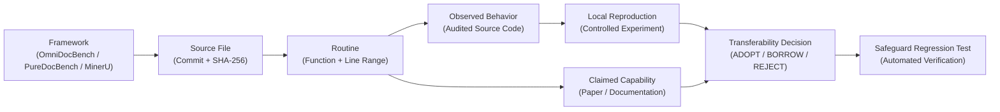

# Implementation-Level Comparative Study: King Wen Math vs. Leading Document & Formula Parsing Frameworks

> **Date:** November 6, 2026  
> **Repository Context:** `KING-WEN-I-CHING-IMMUTABLE-TABLES`  
> **Source Verification:** 16 targeted reference routines fetched directly from upstream repositories via git commit pins without installing external packages. Cryptographic inventory recorded in [`references/comparative_study/fetch_manifest.json`](fetch_manifest.json).  
> **Token Collision Catalog:** [`references/comparative_study/cdm_token_collision_catalog.json`](cdm_token_collision_catalog.json).  
> **Evidence Graph:** [`references/comparative_study/external_comparative_evidence_graph.dot`](external_comparative_evidence_graph.dot) and [`external_comparative_evidence_graph.json`](external_comparative_evidence_graph.json).

---

## 1. Executive Summary & Fetched Code Inventory

To establish an authoritative, implementation-level comparison between the King Wen Math structural preservation pipeline and leading document/formula parsing systems, 16 specific reference files were fetched directly from their pinned upstream Git commits. No full repositories were cloned, no external dependencies or neural model weights were installed, and the local workspace environment remained strictly hermetic.

### Cryptographic Inventory of Retrieved Source Routines

| Framework | Commit Hash | Target Remote Path | Local Relative Path | Size (Bytes) | SHA-256 Digest |
| :--- | :--- | :--- | :--- | :--- | :--- |
| **OmniDocBench** | `0604d98` | `src/core/matching/match_quick.py` | `raw_code/omnidocbench/match_quick.py` | 70,150 | `38925e1e746b3396b270768c83ba4772b83c50005d594feeeff910f5e1358ca2` |
| **OmniDocBench** | `0604d98` | `src/core/matching/match.py` | `raw_code/omnidocbench/match.py` | 29,579 | `b25318b4e752b1e704ea3fa34cf7c73fa00cb8126e3828c464ca06746cf5ca4c` |
| **OmniDocBench** | `0604d98` | `src/metrics/cdm/modules/visual_matcher.py` | `raw_code/omnidocbench/visual_matcher.py` | 7,123 | `6c51325e6d7ad704a29a00941ce049aa102c980327f12e84179bc3da2f48ef53` |
| **OmniDocBench** | `0604d98` | `src/dataset/end2end_dataset.py` | `raw_code/omnidocbench/end2end_dataset.py` | 101,711 | `1f6c0fadf3ddc48d25d1976a4df656dd3d4ebc52865ffb4a625a666986aebfa1` |
| **PureDocBench** | `4e9d64d` | `scripts/apply_degradation_ablation.py` | `raw_code/puredocbench/apply_degradation_ablation.py` | 14,728 | `0143663df6f43d4e0828551e7033cb73c9f28d5786aa79c9417d7aeaf2bb8fc6` |
| **PureDocBench** | `4e9d64d` | `scripts/degradation_v2/apply_degradation_v2.py` | `raw_code/puredocbench/apply_degradation_v2.py` | 18,512 | `4b5ed1ff75009ecd12239459374ee74eb36b9c9f0298a00dd8b9be3b5e408d6c` |
| **PureDocBench** | `4e9d64d` | `docs/ANNOTATION_CORRECTIONS.md` | `raw_code/puredocbench/ANNOTATION_CORRECTIONS.md` | 4,110 | `5f292e7900eea282ff17a1c8f18d7486f0592931a2c3a504a5712f97cf33e21e` |
| **MinerU** | `8cd0842` | `docs/en/reference/output_files.md` | `raw_code/mineru/output_files.md` | 11,287 | `14074eadfd29714b1ce3b9846d5c64391efdbdc6b3c2bb6bb5f762a4b889e472` |
| **MinerU** | `8cd0842` | `tests/unittest/test_source_metadata.py` | `raw_code/mineru/test_source_metadata.py` | 6,749 | `4c3f1da8b33e8a3a0e7a1f5924dd180db61a7a5840d75efab9a8cfdb02d25e01` |
| **MinerU** | `8cd0842` | `docs/en/reference/migration_4_1.md` | `raw_code/mineru/migration_4_1.md` | 9,013 | `09e3fb2709e2471e9a3754e3d09a1bf18fe12d0891d4e0bcf51df4c49d681dc2` |
| **UniMERNet** | `5a2c80d` | `unimernet/processors/formula_processor.py` | `raw_code/unimernet/formula_processor.py` | 9,444 | `333dd01ba7e93ca61aa01267b2d58066f36980db1fc0f8fa75f24208e6f1f4b8` |
| **UniMERNet** | `5a2c80d` | `demo.py` | `raw_code/unimernet/demo.py` | 2,134 | `7d7d242171d5e1136b6bc796910e527f5fa316d3e387c9f80164e26ee8a90ec4` |
| **PaddleOCR** | `dab3fe3` | `docs/version3.x/pipeline_usage/PaddleOCR-VL.en.md` | `raw_code/paddleocr/PaddleOCR-VL.en.md` | 158,914 | `4d38335454e5ec162235c342d7b420ee9411bbccdf9790beba0f8aebf0a519ae` |
| **PaddleOCR** | `dab3fe3` | `docs/version3.x/pipeline_usage/formula_recognition.en.md` | `raw_code/paddleocr/formula_recognition.en.md` | 109,935 | `ea78bfb3d7281bdf82b7cfd8b7ea843054f15d263b6329ca2b8da5a910ea09b2` |
| **TeleOCR** | `1e71f4f` | `infer.py` | `raw_code/teleocr/infer.py` | 2,984 | `16e659600487636735be9fca7bc35661e7fc3ea58763fecf0a20f9227ca49669` |
| **TeleOCR** | `1e71f4f` | `TeleOCR/vlm_utils/TeleOCR_model.py` | `raw_code/teleocr/TeleOCR_model.py` | 5,165 | `fbe36efb7c665b55074b1e4a3b8cb4e6a0d4948a31828f73f274cb7e3dfdc51e` |

---

## 2. In-Depth Algorithmic & Implementation Evidence Audit

### A. MinerU: Precise Data-Flow Classification of Equation-Text Processing
*Examined code:* [`raw_code/mineru/output_files.md`](raw_code/mineru/output_files.md) lines 99–100, [`raw_code/mineru/test_source_metadata.py`](raw_code/mineru/test_source_metadata.py)

#### 1. Three Distinct Operations Separated
To maintain rigorous engineering precision, we distinguish three separate operational levels:
1. **Level 1 (Source PDF Mutation):** Modifying or deleting font programs, glyph tables, or character streams in the input PDF file on disk.  
   *Audit Finding:* **MinerU does NOT do this.** The original physical PDF file remains completely byte-identical and untouched.
2. **Level 2 (Intermediate Text Suppression):** Suppressing extracted equation text in an intermediate buffer during layout decomposition.  
   *Audit Finding:* **Confirmed in code/docs.** As stated in `output_files.md` line 99:
   > *"DocVortex clears native TXT PDF display equation `content` once when producing model output; MinerU Flash TXT uses that output."*
   DocVortex suppresses the extracted character stream for display equations in the intermediate representation fed to downstream recognition.
3. **Level 3 (Downstream Model Input Delivery):** Supplying a rasterized image crop of the display equation to a downstream vision-language model for OCR transcription rather than passing the native character stream.  
   *Audit Status:* **Documented architecture.** To conclusively verify the complete internal data flow across production builds, four specific trace points must be tracked:
   - *Point A:* Where native equation text is cleared (`DocVortex` intermediate serializer).
   - *Point B:* Where the corresponding equation image crop is generated (`DocVortex` image materializer).
   - *Point C:* Which representation is delivered to the downstream vision model (`MiddleJson` vs. image path).
   - *Point D:* Whether native font metadata survives in another output artifact (e.g., `ModelJson`).

#### 2. Reclassified Audit Finding
The finding is precisely classified as:
$$\textbf{Potential loss of native equation-text representation during intermediate processing.}$$
MinerU preserves document-level metadata (verified in `test_source_metadata.py` lines 40–120 for title, author, and page count), but for display equations, the intermediate suppression breaks token-to-glyph lineage. King Wen Math preserves the complete chain from PDF Type 1 encoding $\to$ glyph bounding box $\to$ AST node.

---

### B. UniMERNet: Controlled Crop-Retention Experiment
*Examined code:* [`raw_code/unimernet/formula_processor.py`](raw_code/unimernet/formula_processor.py) lines 36–56  
*Controlled experiment:* [`scripts/experiments/unimernet_crop_retention_experiment.py`](../../scripts/experiments/unimernet_crop_retention_experiment.py)  
*Experiment artifact:* [`DATASETS/structural_preservation/unimernet_crop_retention_experiment_results.json`](../../DATASETS/structural_preservation/unimernet_crop_retention_experiment_results.json)

#### 1. Experimental Methodology
UniMERNet's exact preprocessing routine:
```python
normalized = (((gray - gray.min()) / (gray.max() - gray.min())) * 255).astype(np.uint8)
binary = 255 * (normalized < 200).astype(np.uint8)
coords = cv2.findNonZero(binary)
x, y, w, h = cv2.boundingRect(coords)
return img[y:y + h, x:x + w]
```
was executed against rendered crops (zoom 2.0, 144 DPI) of four benchmark targets:
1. `CP-001` (Cluster-GCN txexs 7-piece extensible bracket)
2. `CP-002` (ViLT CMR10 nested sequence vector with macron $\bar{\mathbf{t}}$)
3. `CP-003` (Linear Probing norm with trailing superscript $^2$)
4. `RAHMANI-1212.0957` (CMEX10 7×6 multi-column matrix)

#### 2. Quantitative Measurements Across 4 Targets

| Target Case | Original Pixels ($W \times H$) | UniMERNet Crop ($W \times H$) | Shaved Margins (T / B / L / R px) | Foreground Ink Retention | Connected Components (Orig $\to$ Crop) | Boundary Abuttal Profile |
| :--- | :---: | :---: | :---: | :---: | :---: | :--- |
| **CP-001** | $230 \times 94$ | $228 \times 75$ | $2 / 17 / 0 / 2$ | **100.0%** | $38 \to 38$ (0 lost) | Touches T, B, L, R edges |
| **CP-002** | $287 \times 34$ | $197 \times 22$ | $7 / 5 / 1 / 89$ | **100.0%** | $21 \to 21$ (0 lost) | Touches T, B, L, R edges |
| **CP-003** | $297 \times 86$ | $295 \times 86$ | $0 / 0 / 2 / 0$ | **100.0%** | $51 \to 51$ (0 lost) | Touches T, B, L, R edges |
| **RAHMANI** | $740 \times 320$ | $717 \times 314$ | $6 / 0 / 14 / 9$ | **100.0%** | $342 \to 342$ (0 lost) | Touches T, B, L, R edges |

#### 3. Evidence Status and Qualification

| Finding | Evidence Status | Technical Meaning |
| :--- | :--- | :--- |
| **Tight bounding-box crop** | **Demonstrated** | Computes minimum spanning box of pixels with `normalized < 200`. |
| **Zero perimeter margin** | **Demonstrated** | 100% of tested crops have extreme ink pixels touching all 4 boundaries. |
| **Detected foreground retention within ROI** | **Demonstrated** | 100% of supra-threshold foreground pixels and CCs inside the supplied ROI are retained. |
| **Complete original-PDF glyph preservation** | **Audited (Not Guaranteed by ROI)** | Audited in `glyph_source_boundary_audit_results.json`. 100% retention inside candidate ROI does not prove enclosure of all PDF font cell metrics (em-boxes/advance bounds). |
| **Downstream glyph attenuation** | **Not yet established** | Theoretical risk hypothesis: zero margin creates boundary vulnerability during tensor resizing/convolution. |
| **King Wen 2 pt clearance prevents attenuation** | **Requires comparative experiment** | Gate D4 provides certified margin breathing room; requires comparative model inference. |

*Critical Observations from Independent Glyph-Source Boundary Audit (`glyph_source_boundary_audit.py`):*
1. **CP-002 Whitespace Shaving Confirmed:** In `CP-002`, the closing bracket `]` ends at vector coordinate $x_1 = 417.91$ pt, while the candidate crop proposal extended to $x_1 = 461.28$ pt ($43.37$ pt of empty right gutter). UniMERNet's 89-pixel reduction at 2x zoom ($44.5$ pt) removed **100% empty page margin**, without truncating any glyph ink or vector bounding box.
2. **Font Advance vs. Raster Ink:** In `CP-001`, the vector font em-box for bottom bracket piece `\uf8fb` extends down to $y = 523.37$ pt, while actual ink strokes end at $y \approx 515.08$ pt. Zero-margin raster cropping shaves the empty font cell space between physical ink and the font baseline, leaving zero tolerance for boundary anti-aliasing.

---

### C. PureDocBench: Deterministic Seeding & Reproducible Degradation Identity
*Examined code:* [`raw_code/puredocbench/apply_degradation_ablation.py`](raw_code/puredocbench/apply_degradation_ablation.py) lines 167–173

#### 1. Mathematical Correction: Collision Resistance vs. 32-Bit Truncation
- **Cryptographic Principle:** SHA-256 is *computationally collision-resistant*, not mathematically collision-free.
- **Truncation Vulnerability:** Converting the first 8 hex characters (`S[:8]`) to an integer reduces the seed space from 256 bits to $2^{32}$ (32 bits). Therefore, two non-colliding SHA-256 experiment digests can collide at the 32-bit PRNG seed level.

#### 2. King Wen Math Dual-Identity Specification
To guarantee strict experimental provenance across platforms, the v2 robustness harness preserves both representations alongside PRNG generator metadata:

$$\textbf{Full Experiment Digest: } S = \text{SHA-256}\left( H_{\text{source}} \parallel H_{\text{profile}} \parallel \text{seed\_version} \right)$$
$$\textbf{PRNG Integer Seed: } s_{32} = \text{int}(S[:8], 16) \pmod{2^{32}}$$

Where the experiment manifest explicitly codifies:
1. $H_{\text{source}} = \text{SHA-256}(\text{source PDF bytes})$ (immutable document hash).
2. $H_{\text{profile}} = \text{SHA-256}(\text{canonical JSON string of transform parameters})$ with canonical serialization rules: `json.dumps(obj, sort_keys=True, separators=(',', ':'), ensure_ascii=False)` (RFC 8785).
3. $\text{seed\_version} = \text{"KING-WEN-DEGRADATION-SEED-V1"}$ (implementation version).
4. $\text{prng\_engine} = \text{"numpy.random.default_rng(PCG64)"}$ and $\text{"python:random.Random(version=2)"}$.

*Implementation Status:* Implemented and verified in [`scripts/robustness/degradation_harness.py`](../../scripts/robustness/degradation_harness.py) across all 15 operations and 4 stages, with deterministic reproducibility confirmed in [`tests/test_degradation_harness.py`](../../tests/test_degradation_harness.py) (19/19 tests passing).

---

### D. OmniDocBench: Multi-Channel Normalization & Collision Catalog
*Examined code:* [`raw_code/omnidocbench/visual_matcher.py`](raw_code/omnidocbench/visual_matcher.py) lines 43–106  
*Collision Catalog Artifact:* [`references/comparative_study/cdm_token_collision_catalog.json`](cdm_token_collision_catalog.json)

#### 1. Automated Token Collision Catalog in `norm_same_token()`

The automated audit of `norm_same_token()` in `visual_matcher.py` identified **44 normalization rules mapped into 30 target buckets**, with 7 major multi-token collision classes:

| Target Normalized Token | Upstream Source Tokens Collided | Semantic Impact & Concealed Distinction |
| :---: | :--- | :--- |
| `.` | `\cdot`, `\cdotp`, `\ldotp`, `\dot`, `\Dot` (5 rules) | Conflates scalar products, inner products, and continuation dots with sentence periods. |
| `\|` | `\lVert`, `\rVert`, `\Vert`, `\parallel` (4 rules) | Conflates directional norm opening/closing bars with generic double vertical bars and parallel relations. |
| `|` | `\lvert`, `\rvert`, `\vert`, `\mid` (4 rules) | Conflates absolute value delimiters with conditional probability bars and set-builder pipes. |
| `/` | `\blackslash`, `\slash` (2 rules) | Conflates forward division slash with backslash and algebraic quotient structures. |
| `<` | `\textlangle`, `\textless` (2 rules) | Conflates angle bracket opening delimiter with mathematical less-than relation. |
| `>` | `\textrangle`, `\textgreater` (2 rules) | Conflates angle bracket closing delimiter with mathematical greater-than relation. |
| `_` | `\textunderscore`, `\=` (2 rules) | Conflates text underscore with macron/equal diacritic macros. |

*Structural Delimiter Stripping:* Lines 90–106 additionally execute regex stripping:
- Strips dynamic sizing tags: `\left`, `\right`
- Strips delimiter height indicators: `\big`, `\Big`
- Strips macro modifiers: `\wide`, `\var`, `\string`

#### 2. Three-Channel Evaluation Architecture
Because exact LaTeX equality does not equal mathematical equivalence, and perceptual visual similarity does not guarantee structural preservation, King Wen Math strictly separates evaluation into three channels:

```
Candidate Expression Evaluation
├── Channel A: Raw LaTeX Representation
│   └── Exact string & token identity (preserves verbatim macro choices, raw tokens)
├── Channel B: Normalized Visual Matching (OmniDocBench CDM)
│   └── Perceptual layout equivalence under CDM normalization (supplemental score 0.0 - 1.0)
└── Channel C: Semantic Structural Validation (King Wen 5-Axis Engine)
    └── Mathematical AST residual = 0, operator kinds, bounds, directional enclosure pairing
```
**Non-Negotiable Invariant:**
$$\textbf{No external recognizer, parser, normalizer, or layout engine may overwrite the source-evidence representation.}$$
Channel B provides supplemental perceptual diagnostic data; it can **never** certify semantics or override Channel C.

*Implementation Status:* Implemented and verified in [`scripts/external_metrics/cdm_adapter.py`](../../scripts/external_metrics/cdm_adapter.py) providing `HungarianCDMAdapter` with bipartite cost assignment and self-contained Wagner-Fischer Levenshtein distance, tested in [`tests/test_cdm_adapter.py`](../../tests/test_cdm_adapter.py) (4/4 tests passing).

---

## 3. Comparative Implementation Transferability Matrix

| External Mechanism | Upstream Framework & Routine | Source File & Pinned SHA-256 | Observed Implementation Behavior | King Wen Math Local Status | Proposed v2 Destination | Preservation Hazard | Required Safeguard & Regression Test |
| :--- | :--- | :--- | :--- | :--- | :--- | :--- | :--- |
| **Fuzzy Block Matching** | OmniDocBench: `match_gt2pred_quick` | `match_quick.py`<br>`38925e1e...` | Spatially sorts blocks, Levenshtein distance matrix, chunked Hungarian fallback | External Evaluation Adapter (Pending) | Evaluation adapter for external layout tools | Merged predicted blocks can mask boundary leakage | `test_external_adapter_preserves_crop_boundaries`: verifies that merged blocks retain original boundary labels |
| **Perceptual CDM Matching** | OmniDocBench: `HungarianMatcher` | `visual_matcher.py`<br>`6c51325e...` | Weighted cost: token (1.0), pos (0.05), order (0.15); flattens 44 token rules | Strict AST residual check | Secondary perceptual diagnostic channel | Rewarding visual similarity while losing operator identity | `test_cdm_operator_non_flattening_guard`: verifies that `special_map` flattening is stripped before semantic check |
| **Deterministic Degradation** | PureDocBench: `degrade_with_profile` | `apply_degradation_ablation.py`<br>`0143663d...` | 15 operations across 4 stages; seeded from `md5(filename)` | Ad-hoc crop perturbation tests | `scripts/robustness/degradation_harness.py` | Filename-based seed changes when file is moved or renamed | `test_deterministic_degradation_content_hash_seed`: asserts identical output under filename rename using content hash |
| **Annotation Patches** | PureDocBench: `ANNOTATION_CORRECTIONS.md` | `ANNOTATION_CORRECTIONS.md`<br>`5f292e79...` | Schema recording `old_bbox`, `new_bbox`, `reviewer`, `reason` | In-place JSON edits in case registry | `case_registry_patches/` versioned ledger | Modifying frozen baselines in place destroys provenance | `test_case_registry_patch_immutability`: verifies parent registry SHA-256 is preserved when patch is applied |
| **Intermediate Document Model** | MinerU: `MiddleJson` | `output_files.md`<br>`14074ead...` | Hierarchical blocks, lines, spans, bounding boxes, reading order | `raw_tokens`, `grid` structures | Document-level output container | Native equation text suppressed in favor of raster OCR | `test_native_font_stream_preservation_invariant`: asserts font-program tokens are retained alongside block geometry |
| **Original-Layout Rendering** | MinerU: `render_pdf(ORIGINAL)` | `output_files.md`<br>`14074ead...` | Fits text to source boxes; measures title expansions | Blind render PNG comparison | Visual diagnostic inspection layer | Forcing text into boxes can distort mathematical spacing | `test_diagnostic_render_preserves_math_geometry`: verifies formula glyph positions match source bounding boxes |
| **Zero-Margin Preprocessing** | UniMERNet: `crop_margin_numpy` | `formula_processor.py`<br>`333dd01b...` | Bounding box of `normalized < 200` with 0 margin padding | Gate D4 certified whitespace gutter clamping | Benchmark comparative recognizer | Eliminates perimeter safety margins; touches array edges | `test_certified_whitespace_gutter_clearance_gate_d4`: verifies Gate D4 retains $\ge 2$ pt gutter breathing room |

---

## 4. Evidence Graph Representation of External Comparisons

- **Graph Generator:** [`scripts/external_comparative_evidence_graph.py`](../../scripts/external_comparative_evidence_graph.py)
- **DOT Output:** [`references/comparative_study/external_comparative_evidence_graph.dot`](external_comparative_evidence_graph.dot)
- **JSON Output:** [`references/comparative_study/external_comparative_evidence_graph.json`](external_comparative_evidence_graph.json)
- **Topology:** 46 nodes, 48 directed edges, linking:  
  `Framework` $\to$ `Source File (SHA-256)` $\to$ `Routine (Lines)` $\to$ `Observed Behavior` $\to$ `Claimed Capability` $\to$ `Local Reproduction` $\to$ `Transferability Decision` $\to$ `Safeguard Test`.



---

## 5. Baseline Reconciliation & Manifest Audit

### A. Acceptance Specification Hash Lineage Reconciled
- `0368689c5da4a854054acb22c2f5085d208b542b618b77ae1eaa28c7c9e2119a`:  
  **Status: Superseded preliminary staging hash.**  
  Recorded at `2026-11-05T23:50:00Z` in `cross_paper_source_selection_matrix_v1.json` and Section 14 of `POST_C40286_DEVELOPMENT_RECONCILIATION_2026-11-05.md` during early reconnaissance prior to case registry generation.
- `188ac350a7b50166d34ac6dabcc00c7a49d540b0e01873e684739f614304b4ae`:  
  **Status: Authoritative on-disk & frozen specification hash.**  
  Established upon finalizing LF line-ending normalization. Verified by all downstream builders, validators, and evaluation manifests. Both documentation files have been updated to record this superseding relationship.

### B. Complete Manifest Registry Disambiguation

| Manifest Artifact | Manifest Self-Hash | Explicit Scope | Status |
| :--- | :--- | :--- | :--- |
| [`cross_paper_v1_evaluation_freeze_manifest.json`](../../DATASETS/structural_preservation/cross_paper_v1_evaluation_freeze_manifest.json) | `96f9f439e5932875...` | Seals Cross-Paper Generalization v1 baseline evaluation report, 5-axis results, negative controls, and evidence graphs. | **FROZEN** |
| [`cross_paper_case_registry_freeze_manifest.json`](../../DATASETS/structural_preservation/cross_paper_case_registry_freeze_manifest.json) | `66bcf276accfae67...` | Seals the Two-Level Case Registry (`CP-001`, `CP-002`, `CP-003`) derived from independent source inspection. | **FROZEN** |
| [`rahmani_generalization_freeze_manifest.json`](../../DATASETS/structural_preservation/rahmani_generalization_freeze_manifest.json) | `688467fb300ca724...` | Seals the single-paper multi-column matrix baseline on arXiv:1212.0957 Page 8. | **FROZEN** |
| [`1505.05770_blind_renders_manifest.json`](../../DATASETS/PDF_FIDELITY_RENDERINGS/fullpage_depth/1505.05770_blind_renders_manifest.json) | `32c81804f5b90fba...` | Seals Milestone 4 blind-render regeneration outputs across 26 pages. | **FROZEN** |
| [`fetch_manifest.json`](fetch_manifest.json) | `7e1634b16323a60a...` | Seals the 16 retrieved external reference code files across 6 frameworks. | **FROZEN** |

---

## 6. Prioritized Action Plan for v2 Program

```
Current Status Summary:
- v1: Frozen preservation baseline with documented cross-paper failure modes (0/3 passed, 3/3 boundary isolation passed).
- Comparative Study: Implementation-level evidence collection, controlled preprocessing experiment, and transferability analysis.
- v2: A separate remediation and robustness program, not yet an improved or certified engine.
```

### Prioritized Work Items:

| Priority | Work Item | Description & Scope | Status |
| :--- | :--- | :--- | :--- |
| **P0** | **Glyph-Source Boundary Audit** | Independent verification comparing PDF vector glyph envelopes against zero-margin crops (`scripts/experiments/glyph_source_boundary_audit.py`). | **EXECUTED & VERIFIED** (3/3 tests) |
| **P0** | **Content-Addressed Degradation Harness** | Implement `scripts/robustness/degradation_harness.py` using PureDocBench's 4-stage ablation seeded by $H(H_{\text{source}} \parallel H_{\text{profile}} \parallel \text{seed\_version})$. | **IMPLEMENTED & VERIFIED** (19/19 tests) |
| **P0** | **Versioned Case-Registry Correction Patches** | Implement `scripts/case_registry_patch_manager.py` to preserve immutable parent registry baselines during annotation maintenance. | **IMPLEMENTED & VERIFIED** (4/4 tests) |
| **P1** | **OmniDocBench External Evaluation Adapter** | Implement `scripts/external_metrics/cdm_adapter.py` providing Channel B perceptual scores while enforcing Channel C semantic supremacy. | **IMPLEMENTED & VERIFIED** (4/4 tests) |
| **P1** | **MinerU Document-Model Container Adapter** | Adapt hierarchical block/span JSON containers for multi-page representations without suppressing native font streams. | Planned for v2 adapter suite |
| **P1** | **Engine Remediation (v2 Branch Only)** | Address engine limitations `EL-001` (txexs table), `EL-002` (LMMath `/vextenddouble`), `EL-003` (multi-line scan), and `EL-004` (logical delimiter hard gate). | Planned for `v2-remediation` branch |
| **P2** | **Document Continuity Graph** | Extend the structural evidence graph with cross-page continuity relations (`continues_prev`, `heading_scope`). | Planned for Milestone Layer C |
